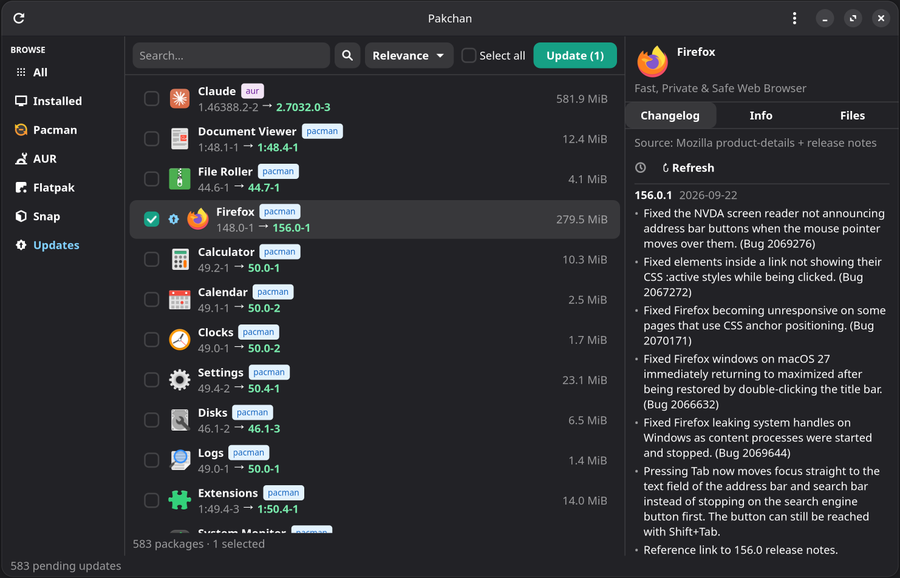

[](https://dodog.github.io/pakchan/web/)
[](https://dodog.github.io/pakchan/web/packages.html)
[](LICENSE)


<picture>
  <!-- Use this image for dark mode -->
  <source media="(prefers-color-scheme: dark)" srcset="/web/img/pakchan-logo-wide_dark.png">
  <!-- Fallback image for light mode and other clients -->
  
</picture>

<br>


**Pakchan** is a GTK4 package manager for Manjaro and Arch Linux based system that fetches **real changelogs** for package updates (Pacman, AUR, Flatpak, Snap) — not just "an update is available."
It also includes a community-driven changelog source database so those sources can be found reliably.


## ❓ Why I created Pakchan
You hit update and your package manager **tells you... nothing**. Just a version number. Most package managers tell you an **update exists, but not what changed**.

Pakchan goes and finds out. It digs up the real release notes — from GitHub, GitLab, the project's own website, Flathub, AUR,  wherever they actually live — and puts them right in front of you before you update anything. 




## 🚀 What you get


### Changelogs that actually mean something
Before you update anything, Pakchan shows you the real changelog for the *version* you're about to install — not the vague version bump. If it can't find one, it tells you why instead of leaving you guessing, and links you to the project's homepage so you can go look yourself. Are curious how it actually finds these? See wiki [How Pakchan works](https://github.com/dodog/pakchan/wiki/How-Pakchan-works).

### Everything on your desktop
Pakchan brings all your packages from Pacman, AUR, Flatpak — installed and installable — into a single, searchable window, sorted the way you'd expect: by installed, by "needs an update," or just by source. Built with GTK4 and libadwaita, so it fits right in — proper icons for your apps, a clean sidebar, keyboard shortcuts.

### Community maintained
Where a package doesn't have an obvious source, the community fills the gap — anyone can [submit a mapping](https://dodog.github.io/pakchan/web/) in a couple of clicks, and it becomes available to everyone.


## 📦 Installation

### Option 1: From the AUR (recommended)

Pakchan is [available on the AUR](https://aur.archlinux.org/packages/pakchan) as `pakchan`. Install it with your AUR helper of choice:

```bash
yay -S pakchan
# or
paru -S pakchan
```

This pulls in all required dependencies (`python`, `python-gobject`, `gtk4`, `libadwaita` 1.5 or newer, `pacman-contrib`) automatically and installs the app launcher and icon, so it'll show up in your app grid right away. Once installed, just launch **Pakchan** from your app menu, or run:

```bash
pakchan
```

Optional extras (listed as optional dependencies of the package): `yay` or `paru` (AUR updates), `flatpak`, `snapd`, `polkit` (graphical password prompt, otherwise `sudo` is used), `git` (PKGBUILD tab and changelogs from git tags), `github-cli` (use your GitHub login for GitHub's request limit) and `vte4` (embedded terminal for update output).

### Option 2: From source

If you'd rather run it straight from a clone of this repo:

```bash
git clone https://github.com/dodog/pakchan.git
cd pakchan
sudo pacman -S python python-gobject gtk4 libadwaita pacman-contrib

#### Optional: AUR support
# yay on Manjaro
sudo pacman -S yay
# or yay on Arch
git clone https://aur.archlinux.org/yay.git && cd yay && makepkg -si
# or paru
git clone https://aur.archlinux.org/paru.git && cd paru && makepkg -si

## Optional: Flatpak support
sudo pacman -S flatpak
flatpak remote-add --if-not-exists flathub https://dl.flathub.org/repo/flathub.flatpakrepo

### Optional: Snap support
sudo pacman -S snapd
sudo systemctl enable --now snapd.socket

#### Run Pakchan
python3 pakchan.py
```

---

## Troubleshooting

**No updates show up?**

- Pacman: ensure `pacman-contrib` is installed (`checkupdates` command)
- AUR: install `yay` or `paru`
- Flatpak: install `flatpak` and add the Flathub remote
- Snap: install `snapd` and make sure `snapd.socket` is running

**Changelog shows "not available"?**

- Some small or niche packages publish no release notes anywhere; Pakchan then shows a link to the project instead
- Flatpak apps not on Flathub won't have AppStream data
- Network access is required to fetch changelog data

**"Request limit reached" for api.github.com?**

Pakchan reads GitHub release notes from each project's public release feed, which has no hourly limit, so you normally don't need to do anything. Only when a feed can't be read does it fall back to GitHub's API, which allows just 60 anonymous requests per hour. If you ever run into that, you can raise it to 5000 with a free GitHub token. It needs no permissions, because Pakchan only reads public release notes:

1. In Pakchan, open **Preferences** (menu → Preferences, or Ctrl+,) and go to the **GitHub** tab.
2. Click **Create a token on GitHub**, log in, leave all the boxes unticked and click **Generate token**.
3. Copy the token (it starts with `ghp_`), paste it into the field and click **Save**.

Pakchan checks the token with GitHub before saving it. It is kept in `~/.config/pakchan/github_token` (readable only by you) and is only ever sent to `api.github.com`. **Preferences → GitHub → Remove token** deletes it.
**No embedded terminal / falls back to a plain-text log?**

- Install `vte4` — Pakchan works fine without it, but a real pty gives `sudo`/`makepkg` prompts more natural behavior

**"No tray found" next to Minimize to tray?**

- KDE and XFCE show Pakchan's tray icon out of the box.
- On GNOME, install and enable the [AppIndicator and KStatusNotifierItem Support](https://extensions.gnome.org/extension/615/appindicator-support/) extension.

**App won't launch?**

```bash
sudo pacman -S python python-gobject gtk4 libadwaita
```

Pakchan needs libadwaita 1.5 or newer.

---

## Package mapping database

Pakchan stores changelog source mappings in `data/mappings.json`, which is fetched, cached, and consumed by the app to resolve the correct source for each package.

### Add a package mapping

- Use the [web form](https://dodog.github.io/pakchan/web/) to submit a package and changelog source.

### Supported mapping types

| Section         | Type       | Description                                              |
| --------------- | ---------- | ---------------------------------------------------------- |
| `github`         | —          | Direct GitHub repo (`owner/repo`) — uses the Releases/Tags APIs |
| `gitlab`         | —          | Direct GitLab repo (`host`/`repo`) — uses the Releases/Tags APIs |
| `forgejo`        | —          | Direct Forgejo/Gitea/Codeberg repo (`host`/`repo`) — uses the Releases/Tags APIs |
| `release_pages`  | —          | Any URL scraped with the generic, best-effort release-notes parser |
| `custom`         | `text_file`| Plain text (or Markdown) changelog file                   |


## ❤️ Support

If Pakchan saves you some digging through websites, news files, commit logs, you can buy me a [coffee ☕](https://buymeacoffee.com/dodog)

[](https://www.buymeacoffee.com/dodog)

## License

MIT — see [LICENSE](https://github.com/dodog/pakchan/blob/main/LICENSE)
